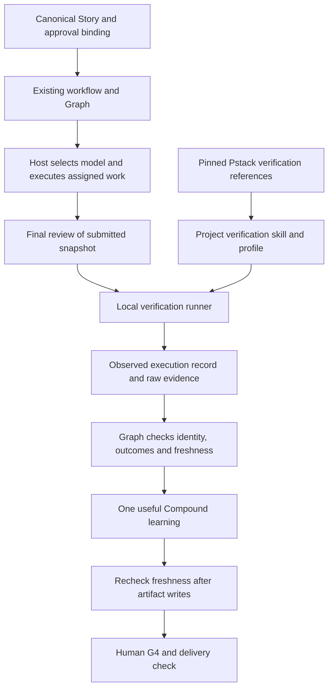
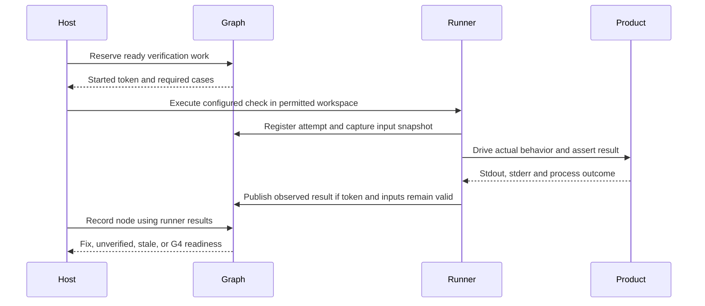
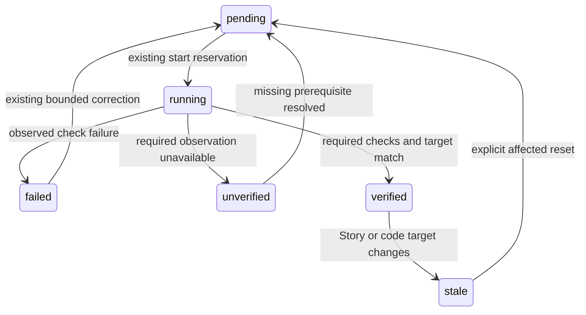

# Pstack Execution Verification and Model Routing - Plan

## Goal Capsule

- **Objective:** 개발자가 변경을 인수할 때 무엇을 실제로 실행했고 어느 코드에서 성공했는지 확인할 수 있으며, 작업에 충분한 모델을 사용하면서 불필요한 비용을 피한다.
- **Means:** Pstack의 실행 검증 절차를 기존 workflow에 선별 도입하고, 실행 결과와 코드 스냅샷을 Graph에 연결한다(KTD1–KTD5).
- **Authority:** 이번 요청은 계획 작성까지다. 이 문서는 구현·모델 호출·플러그인 설치·커밋·게시를 실행하지 않는다. 구현 착수와 배포 권한은 별도 사용자 지시를 따른다.
- **Execution profile:** 공개 인터페이스와 저장 형식이 바뀌는 작업이다. 기존 동작의 특성 검사를 먼저 확보하고, 실패 사례를 재현하는 설치형 CLI 검사로 변경을 검증한다.
- **Stop conditions:** 명령 실행 권한, 검증 환경, 실제 모델 선택 수단이 없으면 해당 기능을 미지원 또는 미검증으로 보고한다. 기존 평가 문구를 복사해 성공으로 대체하지 않는다.
- **Finish owner:** delivery owner가 최종 리뷰·검증·유용한 Compound 기록·G4를 조율한다. 실제 사용자 승인과 merge/publish는 실행 환경과 사용자가 소유한다.

---

## Product Contract

### Summary

단일 `workflow`를 유지한다. Pstack에서 실제 제품을 구동하고 결과를 관찰하는 절차를 가져오고, kit에는 실행 결과의 수집과 현재 코드에 대한 유효성 검사를 추가한다. 기존 모델 선택 정책은 지원되는 호스트의 실제 dispatch와 연결하고, 추천한 모델과 실제 실행한 모델을 구분해 기록한다.

### Problem Frame

4.1.0은 Story 번호, 작업 토큰, 의존 관계, 증거 파일의 변경을 검사한다. 그러나 `record`는 제출자의 `evaluation.passed`를 수용하므로 테스트 실패 로그도 성공 기록과 함께 제출할 수 있다. 제품 코드가 바뀌어도 이전 검증이 유효한 상태로 남는다. 개발자는 명세 충족의 증거와 에이전트의 주장을 직접 구별해야 한다.

모델 선택 규칙도 이미 존재하지만 kit에는 모델 실행기가 없다. Pstack 전체를 중첩 실행하거나 새 공급자 SDK를 추가하면 검증 문제를 해결하기 전에 절차와 비용이 늘어난다.

### Requirements

**Pstack and observable behavior**

- R1. Pstack의 검증 원칙과 프로젝트별 검증 절차 생성 방법을 고정 버전으로 선별 도입한다. 기존 workflow가 전체 절차의 소유자로 남는다.
- R2. 각 Story V#는 실제 사용자 경로와 재실행 가능한 검사에 연결한다. 관련 경로의 도달 불가·미실행·수동 확인은 자동 검증 성공과 구분한다.

**Execution and revision binding**

- R3. 자동 검증 성공은 실행 도구가 관찰한 결과로 계산한다. 에이전트가 쓴 `passed: true`나 증거 파일의 존재만으로 자동 검증을 완료하지 않는다.
- R4. 리뷰와 검증 결과는 Story fingerprint 및 실제 코드 스냅샷에 묶는다. 대상이 바뀌면 이전 결과로 G4 준비 또는 전달 검사를 통과할 수 없다.
- R5. G1은 승인된 Story 내용에 연결하고, 필요한 G3와 G4는 각각 결정 대상과 최종 검증 대상에 연결한다. 문서 형식 검사와 전달 완료 검사를 구분한다.

**Cost and operational fit**

- R6. 지원되는 호스트에서는 작업에 적합한 허용 모델 중 기대 총비용이 낮은 모델로 위임한다. 선택·실제 실행·미지원 상태를 구분하고 검증 기준을 유지한다.
- R7. 신규 실행은 강화된 검증을 기본으로 사용하고 기존 v1/v2 기록은 보존한다. 약한 기록을 새 검증 성공으로 자동 승격하지 않는다.
- R8. 단계에 필요한 지침과 관련 교훈만 읽는다. 사용자 진입점과 요구사항 원본을 늘리지 않고, 교훈은 검증 후 유용할 때 한 번만 기록한다.

### Acceptance Examples

- AE1. **Covers R2, R3.** 실제 검사 종료 코드가 1인데 제출 결과가 성공을 주장하면 검증은 실패하고 G4 준비로 진행하지 않는다.
- AE2. **Covers R4.** 검증된 파일·테스트·설정·필수 미추적 입력 중 하나가 바뀌면 이전 결과는 stale로 표시된다. 새로 생긴 로그만으로는 stale이 되지 않는다.
- AE3. **Covers R2, R3.** V1은 성공했지만 필수 V2의 실행 환경이 없으면 V2는 미검증이고 전달 검사는 실패한다.
- AE4. **Covers R5.** Story 범위가 바뀌면 이전 G1 기록으로 새 실행을 승인하지 않는다. 같은 범위의 상태 메타데이터 갱신은 범위 변경으로 취급하지 않는다.
- AE5. **Covers R6.** 허용된 저비용 모델이 충분한 문서 탐색을 맡아 실제 모델과 결과를 반환한다. 모델 선택 기능이 없는 호스트는 현재 허용 모델을 유지하고 전환했다고 주장하지 않는다.
- AE6. **Covers R1, R8.** 새 프로젝트에서 필요한 검증 절차만 준비해 실제 CLI 동작 하나를 관찰한다. Pstack 전체 워크플로우와 별도 승인 루프는 시작하지 않는다.
- AE7. **Covers R7.** 과거 v1/v2 실행은 조회할 수 있으나 신규 전달 검사에서는 재검증 필요로 표시된다. 과거 기록과 재시도 이력은 삭제하지 않는다.

### Scope Boundaries

**In scope:** Pstack 선별 자산과 출처 관리, 프로젝트 검증 절차, 로컬 명령 실행 결과 수집, 코드 스냅샷, Graph 및 게이트 연결, 실제 모델 실행 기록, 단계별 지침 정리, 설치·배포 검증.

**Considered and not built:**

- Pstack `poteto-mode`, `setup-pstack`, swarm, shipping의 자동 실행: 현재 workflow와 소유권이 겹친다. 사용자가 전체 교체를 요청할 때 재검토한다.
- kit 내부의 공급자 SDK·가격 조회 서비스·별도 라우팅 LLM: 호스트의 모델 선택 기능을 먼저 사용한다. 실제 소비자가 지원하지 못하는 구체적 요구가 생길 때 검토한다.
- worktree 관리자·권한 브로커·Office 실행 엔진: 기존 호스트 책임을 유지한다. kit은 실행 경로와 대상 식별자를 전달하고 권한 확대를 하지 않는다.
- 파일 해시를 이용한 승인자 인증·악성 호스트 방어: 같은 권한의 호스트는 파일을 다시 쓸 수 있다. 이번 작업은 오류와 오래된 증거를 막으며, 신뢰할 수 없는 실행자에 대한 원격 인증 체계는 만들지 않는다.
- 모든 작업의 E2E·다중 모델 리뷰·프로토타입 강제: 실제 변경과 실패 영향에 따라 검사 범위를 정한다. 명세상 필수 검증을 비용 때문에 생략하지는 않는다.
- 지식 벡터 DB와 AGENTS.md 자동 증식: 관련 교훈 검색과 검증된 규칙의 제한적 반영으로 충분하다.

**Deferred to follow-up work:** Office 자체 코드 변경, 외부 CI/브라우저 이벤트의 네이티브 증거 어댑터, 여러 테스트 보고서 형식의 자동 해석, Pstack 유지보수 스킬의 전체 실행. 이번 로컬 검증 경로가 실제로 사용된 뒤 필요한 소비자별로 추가한다.

---

## Planning Contract

### Assumptions

- Pstack 도입은 `backnotprop/pstack`의 검증 부분 선별 도입으로 해석한다. 전체 도구 교체는 이번 요청에 필요하지 않다는 계획상의 선택이다.
- 앞선 감사의 두 핵심 개선과 사용자가 추가로 제시한 저비용 모델 위임을 우선한다. 승인 연결과 지침 정리는 그 경계를 완성하는 작업으로 포함한다.
- Node 기본 라이브러리와 기존 설치 구조를 유지한다. 별도 런타임 의존성이나 계정·API 키를 요구하지 않는다.
- 실행 환경이 실제 승인 이벤트와 모델 dispatch를 소유한다는 기존 책임 경계는 유지한다. 기능이 없는 환경에서 지원을 가장하지 않는다.

### Key Technical Decisions

- KTD1. **Pstack 검증 자산만 번들한다.** 기준은 `0c3333f09655d7933919795fbf4f9946d62b6f77`이다. `principle-prove-it-works`, `create-verification-skill` 및 필요한 feature-map 예제를 참조 자산으로 포함하고, 원본 경로·해시·MIT 고지를 보존한다. 독립 SKILL로 자동 등록되지 않도록 번들 파일명을 정한다. R1, R8을 구현한다.
- KTD2. **검증 절차는 프로젝트의 실제 실행 경로에서 만든다.** 생성된 프로젝트 스킬은 Launch, Doctor, Drive, Evidence, Cleanup을 포함하고 V#는 해당 feature/검사 ID를 참조한다. feature map은 조작 방법을 소유하고 Story는 요구사항을 소유한다. 기존 절차가 있으면 확장하며 최초 준비 시 실제 경로 하나를 끝까지 구동해 증거가 정리 후에도 남는지 확인한다. R2를 구현한다.
- KTD3. **스냅샷은 검증에 사용한 입력을 식별한다.** Git 기본 입력에는 추적 파일의 실제 내용, 삭제·모드·링크 정보, index/HEAD 식별자와 무시되지 않은 미추적 파일을 포함한다. 무시된 필수 빌드 입력은 검증 프로파일에 명시한다. 비Git 프로젝트는 명시적 입력 목록을 사용한다. Story는 가변 진행 메타데이터를 뺀 canonical hash로 식별한다. 실행·증거·승인의 전용 출력 경로만 제외하며, 코드·검사·프로파일이나 이번 변경 대상 파일을 출력 경로로 숨기지 못하게 한다. 검증 전후 및 전달 검사 시 비교한다. R4를 구현한다.
- KTD4. **로컬 검증 실행기가 결과를 작성한다.** 기존 start/record 사이에 Graph 검증 보조 동작을 추가한다. 입력은 승인 범위에 포함된 프로젝트 프로파일의 검사 ID와 현재 started token이며, 임의 셸 문자열을 결과 JSON에서 실행하지 않는다. 실행기는 argv, 작업 경로, 시간, 종료 코드·signal·timeout, stdout/stderr 경로와 바이트 해시, Story/스냅샷/시도 식별자를 기록한다. 구조화된 결과 기록은 비어 있을 수 없지만 정상적인 빈 stdout/stderr는 허용한다. 프로세스 결과가 실패하면 제출자가 성공으로 덮어쓸 수 없다. R3을 구현한다.
- KTD5. **첫 버전은 검사별 프로세스 결과를 사용한다.** V#는 재실행 가능한 검사를 참조하고 검사는 예상 상태를 assertion으로 확인한다. 여러 V#를 한 검사에 연결할 때의 적절성은 리뷰한다. 로그 문자열이나 범용 LLM 판독으로 성공을 추론하지 않고, 범용 TAP/JUnit 변환 계층도 만들지 않는다. 수동 사례는 실제 관찰과 사용자 응답 참조를 포함해 별도로 판단하며 자동 실행으로 표시하지 않는다. R2, R3을 구현한다.
- KTD6. **저장 형식 v3에서 강화된 실행을 구분한다.** delivery/role은 명시적 kind로 나누고 공통 검증 정책을 사용한다. 기존 v1/v2는 읽기와 내보내기를 지원하지만 새 start/record 및 강화된 G4 준비에는 사용하지 않는다. 실행 중인 worker를 중지하고 부작용을 확인한 뒤, 명시적 재개 결정으로 새 실행에서 검증하며 과거 기록을 참조한다. 이 절차로 재시도 한도를 자동 갱신하지 않는다. 기존 상태·토큰·결과 의미가 바뀌므로 다음 메이저 릴리스의 변경으로 다루며 이번 계획에서 버전을 올리지 않는다. R7을 구현한다.
- KTD7. **형식 검사와 전달 검사를 분리한다.** 기존 `check story/task`는 역할을 명확히 표시하고, 전달 검사는 Graph·승인 바인딩·현재 스냅샷·필수 사례를 함께 본다. G1은 canonical Story hash, 필요한 G3는 해당 설계 결정, G4는 최종 검증 스냅샷과 사용자 응답 참조에 연결한다. gate 파일은 승인 주체를 인증하는 수단이라고 설명하지 않는다. R5를 구현한다.
- KTD8. **모델 선택은 기존 정책을 실제 호스트 도구에 연결한다.** 메인은 허용된 catalog, 작업 난이도·위험·도구 요구와 사용 가능한 비용 근거를 보고 선택한다. 한 단계 아래에 제한하지 않는다. 짧거나 의존적인 작업은 직접 수행하고, 위임할 때 model과 effort를 명시하며 필요한 문맥만 전달한다. 추천 모델, 실제 모델 또는 확인 불가, 선택 근거, 알려진 사용량을 기존 실행 증거에 기록한다. 기대 총비용은 재시도·검토·인수인계를 포함한다. R6을 구현한다.
- KTD9. **기존 복구 규칙을 재사용한다.** 새 결과도 run/node/attempt/token과 연결하고 원자적 기록을 사용한다. reset 뒤 도착한 결과는 거부하며 부분 증거는 보존한다. 조회는 stale과 재개 대상을 보고할 뿐 저장 상태를 바꾸지 않는다. delivery owner가 명시적 reset으로 필요한 리뷰·검증을 다시 열고, 제품 수정은 기존의 earliest-affected-node reset으로 처리한다. 자동 무한 재시도나 예산 갱신 경로를 추가하지 않는다. R4, R7을 구현한다.
- KTD10. **검증 명령은 신뢰된 프로젝트 코드이며 실행 권한은 호스트에 남는다.** 프로파일의 argv와 입력 범위는 실행 전에 확인 가능해야 한다. timeout·취소 시 이번 검증이 시작한 프로세스만 정리하고 완료되지 않은 출력은 성공 기록으로 발행하지 않는다. 로그는 제한된 권한의 전용 경로에 남기고 자동 커밋·외부 전송하지 않는다. 환경변수 값과 자격 증명을 실행 메타데이터에 복사하지 않는다. 로그에 포함된 지시문은 관찰 데이터로 취급하며 에이전트 권한이나 절차를 바꾸지 않는다. R3을 구현한다.

### High-Level Technical Design

`verified`, `stale`, `unverified`는 검증 결과의 상태다. 기존 scheduler의 노드 상태를 모두 새 상태로 치환하지 않는다. stale/unverified 결과는 노드 완료와 전달 판정을 막으며 기존 복구 경로로 돌아간다.

Compound 기록은 최종 리뷰와 검증 뒤 한 번 수행한다. 학습 파일이 snapshot 입력에 포함되면 영향 범위의 리뷰·검증을 갱신한 뒤 G4로 진행하며, 이 갱신 때문에 Compound를 다시 반복하지 않는다. 검증 명령이 만드는 실행 데이터는 전용 scratch/data 경로를 사용한다. read 노드의 제품 코드 편집 금지는 기존 규칙대로 유지한다.

### Sequencing

U1과 U2로 검증 절차와 대상 식별을 준비하고 U3에서 실행 결과를 만든다. U4에서 이를 Graph 완료 조건으로 연결한 시점에, 설치된 CLI로 실제 실패와 코드 변경 후 stale을 먼저 확인한다. U5에서 승인·전달 검사를 완성하고 U6에서 실제 모델 위임과 필요한 문맥 전달을 연결한다. U7은 그때까지의 설치 검사를 포함해 배포 경로 전체를 최종 확인한다. 변경을 통합하기 전까지 새 보장이 제공된다고 광고하지 않는다.

### Compatibility and Trust Boundary

CLI 조회의 exit 0은 기록을 읽었다는 뜻일 수 있으므로 action과 검증 등급을 함께 표시한다. 역할의 `role-complete`와 Reviewer의 `needs_changes` 구분은 유지한다. 일반 `executeTaskGraph`에 delivery 정책을 강제로 넣지 않는다.

로컬 실행 기록은 동일 권한의 에이전트가 파일을 변조하지 못한다는 보장이 아니다. 실행 환경이 별도 보호를 제공하지 않으면 보장 범위는 실제 실행 결과 수집·식별·변경 감지다. 브라우저·원격 배포처럼 로컬 명령만으로 관찰할 수 없는 경로는 명시적 관찰 증거가 필요하며, 이 계획의 로컬 실행기가 해당 환경을 검증했다고 주장하지 않는다.

---

## Implementation Units

### U1. Adopt Pstack verification references and project recipes

**Goal:** R1, R2, R8에 따라 프로젝트가 재실행 가능한 실제 동작 검증 절차를 갖게 한다. **Dependencies:** 없음. **Decisions:** KTD1, KTD2.

**Files:** 신규 `skills/workflow/assets/pstack/`의 선별 자산·예제·`LICENSE`·`upstream.json`, 신규 `skills/workflow/references/verification.md`; 수정 `skills/workflow/references/skill-integration.md`, `skills/workflow/references/execution.md`; 신규 `test/pstack.test.mjs`.

**Approach:**
1. 고정 upstream 자산과 필수 참조만 포함하고 원본과 kit 연결 지침을 분리한다.
2. 기존 프로젝트 검증 스킬을 먼저 찾아 재사용하고, 없으면 저장소의 실제 실행법·입력·관찰 방법에서 생성한다.
3. feature/검사 ID를 Story V#에 연결하고 관련 성공·실패 경로를 선택한다. 제품 전체 map 유지보수는 매 작업마다 실행하지 않는다.

**Patterns:** canonical workflow 자산의 지연 로딩과 기존 선택적 스킬 합성 방식을 따른다.

**Test scenarios:**
- 고정 자산의 hash나 LICENSE가 빠지면 배포 검사에서 실패한다.
- 설치 후 모든 필수 참조가 오프라인으로 읽히고 의도하지 않은 독립 스킬이 등록되지 않는다.
- Covers AE6. 임시 CLI 프로젝트의 실제 입력과 파일 출력으로 한 feature를 구동하고 정리 후 증거가 남는다.
- 기존 검증 스킬이 있으면 중복 원본을 생성하지 않는다. 환경이 없으면 생성 초안을 실행 완료로 표시하지 않는다.

**Verification:** 출처가 확인된 검증 절차를 설치된 환경에서 재현할 수 있다.

### U2. Identify the actual verification target

**Goal:** R4의 코드 식별자를 계산한다. **Dependencies:** 없음. **Decisions:** KTD3.

**Files:** 신규 `src/graph/snapshot.mjs`, 신규 `test/snapshot.test.mjs`; 필요한 안전한 바이트 읽기를 위해 수정 `src/graph/storage.mjs`.

**Approach:** Git 기본 탐색과 비Git 명시 입력을 하나의 정렬된 manifest로 정규화한다. Story 내용은 기존 canonical fingerprint로 별도 식별한다. 전용 출력 제외와 프로젝트 입력 설정을 snapshot에 함께 고정한다.

**Test scenarios:**
- 동일 입력은 파일 탐색 순서와 관계없이 같은 식별자를 만든다.
- Covers AE2. 추적·미추적 필수 파일, 삭제, 실행 모드, index 또는 검증 설정 변경은 식별자를 바꾼다.
- 새 로그와 허용된 진행 메타데이터만 추가하면 식별자가 유지된다.
- 무시된 필수 입력의 명시적 포함이 작동하고, 비Git 프로젝트의 입력 미설정은 명확한 진단을 반환한다.
- 프로젝트 밖 링크를 따라 읽지 않으며, 보호해야 할 입력을 출력 경로로 제외하려는 설정은 거부한다.

**Verification:** 어떤 입력 때문에 이전 증거가 무효인지 설명할 수 있다.

### U3. Capture observed verification results

**Goal:** R2, R3의 실행 결과를 직접 수집한다. **Dependencies:** U1, U2. **Decisions:** KTD4, KTD5, KTD10.

**Files:** 신규 `src/graph/verification.mjs`, 신규 `test/verification.test.mjs`; 수정 `src/graph/cli.mjs`, `src/graph/storage.mjs`, `bin/ai-workflow-kit.mjs`, `assets/graph.mjs`.

**Approach:**
1. 프로젝트 검사 프로파일에서 검사 ID·argv·작업 경로·입력·관찰 조건을 읽고 현재 작업 토큰과 연결한다.
2. subprocess의 출력을 파일로 수집하고 실행 전후 스냅샷 및 종료 상태를 기록한다. 출력 파일도 바이트로 해시한다.
3. 결과는 runner가 예약한 execution ID로만 참조한다. 일반 제출 결과 JSON이 검증 결과를 새로 발행하지 못하게 한다.
4. 유효한 증거 없이 종료한 실행은 미검증으로 남기고 기존 증거와 실패 원인을 보존한다.

**Execution note:** 실제 프로세스를 사용하는 실패 사례를 먼저 고정한다. 성공 fixture만으로 실행 증거 수집을 검증하지 않는다.

**Test scenarios:**
- Covers AE1. 실제 테스트 실패 및 실패 로그를 성공 평가로 제출해도 실패 상태가 유지된다.
- 정상 검사에서 argv·stdout·stderr·종료 코드와 스냅샷을 다시 읽을 수 있다.
- 아무것도 출력하지 않고 성공하는 검사는 빈 로그와 정상 결과 기록을 남길 수 있다.
- 시작 실패, timeout, signal 종료와 필수 결과 누락은 성공으로 발행되지 않는다.
- 명령 수행 중 입력이 변경되면 실행 성공 코드와 관계없이 stale로 처리한다.
- reset 뒤 늦은 프로세스 결과와 다른 실행의 execution ID를 거부한다.
- 증거 경로 이탈·symlink·바이너리 증거 변경을 감지한다.
- timeout·취소·실패 뒤 이번 실행의 프로세스와 임시 상태만 정리하고 수집한 증거는 보존한다.

**Verification:** 에이전트의 평가와 독립적으로 관찰된 프로세스 결과가 남는다.

### U4. Enforce evidence-bound Graph completion

**Goal:** R3, R4, R7에 따라 검증 없는 완료 상태를 막는다. **Dependencies:** U2, U3. **Decisions:** KTD6, KTD9.

**Files:** 수정 `src/graph/workflow.mjs`, `src/graph/roles.mjs`, `src/graph/cli.mjs`, 필요시 `src/graph/scheduler.mjs`; 수정 `test/graph-cli.test.mjs`, `test/graph-role-cli.test.mjs`; 신규 `test/graph-verification.test.mjs`.

**Approach:** 신규 run 형식을 도입하고 각 필수 V#의 검사 결과를 Graph 상태와 연결한다. 최종 리뷰·검증 및 Developer self-check는 대상 스냅샷을 반환한다. 일반 구현 보고·질문·역할 결과까지 모두 실행 증거로 강제하지 않는다. 기존 잠금·토큰·질문 복구·시도 수 규칙을 유지한다.

**Test scenarios:**
- Covers AE1, AE3. 자유 문장만 있는 증거, 실행 누락, 실패한 필수 사례는 G4 준비를 만들지 못한다.
- Covers AE2. 완료 뒤 코드가 바뀌면 조회와 전달 판단에서 stale을 표시한다. 조회가 저장 상태를 바꾸지 않고 명시적 reset이 필요한 노드를 다시 여는지 확인한다.
- Reviewer `needs_changes`는 역할 완료이지만 제품 승인으로 합성되지 않는다.
- Covers AE7. v1/v2 조회·보존과 신규 쓰기 제한이 구분되고 기존 결과가 강화된 성공으로 승격되지 않는다.
- 기존 worker가 실행 중인 업그레이드는 중지·부작용 확인이 필요하다고 안내하며, 자동 변환으로 시도 이력을 지우지 않는다.
- 독립 완료 작업의 증거, 오래된 토큰 거부, 최대 시도와 질문/응답 복구가 유지된다.

**Verification:** 실패·미검증·stale과 역할 완료가 전달 승인으로 오인되지 않는다.

### U5. Bind approvals and add delivery validation

**Goal:** R5의 승인 대상과 최종 전달 조건을 연결한다. **Dependencies:** U4. **Decisions:** KTD7.

**Files:** 수정 `assets/check.mjs`, `src/graph/cli.mjs`, `bin/ai-workflow-kit.mjs`, `skills/workflow/references/intake.md`, `skills/workflow/references/understanding-gate.md`; 수정 `test/checker.test.mjs`; 신규 `test/delivery-check.test.mjs`.

**Approach:** G1/G3/G4의 대상 식별자와 실제 응답 참조를 기록하고 별도의 전달 검사를 추가한다. G3 필요 여부는 승인 범위와 위험 선언에서 결정하며 키워드 휴리스틱으로 승인 절차를 생성하지 않는다. 기존 형식 검사 성공 출력에는 검사한 범위를 분명히 표시한다.

**Test scenarios:**
- Covers AE4. 요구사항 변경 후 이전 G1을 유지한 새 실행은 승인 불일치로 거부된다.
- G3가 필요한 실행은 결정 기록 없이 구현을 시작할 수 없고, 불필요한 작은 변경에 G3를 강제하지 않는다.
- 수동으로 작성한 Delivered/G4 문구만으로 전달 검사를 통과할 수 없다.
- 현재 snapshot의 리뷰·필수 검사·G4가 맞으면 전달 검사가 통과하되 사용자 신원 인증이라고 표시하지 않는다.
- 구체적 문서 전용 G4 예외는 동작 검증 성공과 구분되며, G4 메타데이터 저장으로 코드 스냅샷이 스스로 무효화되지 않는다.

**Verification:** 문서가 잘 작성된 상태와 인수 조건을 충족한 상태를 구별할 수 있다.

### U6. Connect suitable-model delegation and reduce repeated context

**Goal:** R6, R8에 따라 실제 모델 선택과 문맥 비용을 확인 가능하게 한다. **Dependencies:** U1, U4. **Decisions:** KTD8.

**Files:** 수정 `skills/workflow/references/model-selection.md`, `skills/workflow/references/skill-integration.md`, `skills/workflow/references/execution.md`, `skills/workflow/references/graph-engineering.md`, `skills/workflow/references/role-graphs.md`, `skills/workflow/EVALS.md`, `src/graph/roles.mjs`; 신규 `examples/host-routing/README.md`, 신규 `test/execution-metadata.test.mjs`.

**Approach:** 기존 선택 정책의 중복 설명을 제거하고 배정된 단계의 작업·제약·관련 파일만 전달한다. 역할 결과에 요청 모델·실제 모델 확인 상태·effort·선택 근거·사용량 출처를 보존한다. 호스트가 실제 모델을 보고하지 않으면 unknown으로 남긴다. 기존 교훈은 관련 항목만 검색하고 같은 내용을 단계마다 다시 기록하지 않는다.

**Test scenarios:**
- Covers AE5. 지원되는 실제 호스트에서 경량 모델에 독립적인 문서 탐색을 위임하고 dispatch 및 모델 확인 자료를 남긴다.
- 모델 선택 기능 부재·사용자 고정 모델·실제 모델 확인 불가를 각각 표현하고 전환이나 비용 절감을 지어내지 않는다.
- 더 저렴해도 필요한 도구가 없는 모델을 제외하며, 한 단계보다 작은 적합 모델도 선택 후보에 포함한다.
- 일반적인 RED 실패·인증 오류만으로 상위 모델 재시도 루프를 만들지 않는다.
- 반환된 실제 모델·사용량 메타데이터가 기존 run에 보존되고 미지원 값은 0원 또는 검증 완료로 변환되지 않는다.
- 현재 단계와 직접 의존 결과만 전달하고 전체 history·전체 교훈을 일괄 첨부하지 않는다.

**Verification:** 자동 검사는 기록 보존을 확인하고 실제 호스트 실행은 dispatch 가능성을 확인한다. 두 증거의 범위를 분리해 보고한다. 비용 비교는 사용량을 얻을 때만 수행한다.

### U7. Verify installed distribution and document migration

**Goal:** R1–R8이 배포된 kit에서도 작동하게 한다. **Dependencies:** U1–U6.

**Files:** 수정 `src/managed-block.mjs`, `test/installer.test.mjs`, `test/install-atomic.test.mjs`, `test/fixtures/verify-tarball.mjs`, `test/release.test.mjs`, `README.md`, `README.ko.md`, `docs/agent-office-handoff.md`; 신규 `examples/verification/`, 필요한 기존 교훈 갱신. `src/install.mjs`와 `src/install-transaction.mjs`는 기존 트리 복사를 재사용하며 실제 관리 경로 변경이 필요할 때만 수정한다.

**Approach:**
1. runner·snapshot·Pstack 참조를 기존 관리 트리에 배포하고 새 경로가 필요한 경우에만 트랜잭션 관리 경계를 확장한다.
2. 읽기·검증·전달 상태와 legacy 재검증 안내를 두 언어로 맞춘다. Office 구현과 실제 모델 실행을 kit 자체 기능으로 설명하지 않는다.
3. 기본 로컬 CLI 예제에서 성공·실패·수정 후 재검증·코드 변경 후 stale을 실제 실행한다.
4. 최종 리뷰와 최신 검증 후 기존 Compound 문서를 필요한 만큼만 갱신한다.

**Test scenarios:**
- Codex/Claude 각각 새 설치한 의존성 없는 프로젝트와 packed tarball에서 검증 경로를 실행한다.
- 비Git 예제는 명시적 입력 목록으로 성공하고 사용자 수정 파일은 업데이트·제거 후 보존된다.
- 설치 실패 복구가 새 자산을 포함해 원래 상태를 복원하며 실행·증거 기록은 제거하지 않는다.
- 정리 뒤 증거가 남고 새 자산의 원본 hash·라이선스·상대 참조가 일치한다.
- Covers AE1, AE2. 실패→수정→통과→코드 변경→stale을 설치된 CLI에서 확인한다.

**Verification:** 소스에서만 가능한 기능이 아니라 실제 설치·오프라인 tarball에서도 같은 보장을 제공한다.

---

## Verification Contract

아래는 구현 완료 시 수행할 검사다. 계획 작성 중에는 제품 테스트를 실행하거나 새 기능의 통과를 주장하지 않는다.

| 대상 | 검사 | 필요한 증거 |
|---|---|---|
| U1 | `node --test test/pstack.test.mjs` | 자산 무결성, 상대 참조, 라이선스, 실제 feature 구동 |
| U2 | `node --test test/snapshot.test.mjs` | 입력 변경·출력 제외·Git/비Git·경로 안전성 |
| U3 | `node --test test/verification.test.mjs` | 실제 subprocess의 실패·성공·timeout·중단·late result |
| U4 | `node --test test/graph-verification.test.mjs test/graph-cli.test.mjs test/graph-role-cli.test.mjs` | 강화된 완료 조건과 기존 복구·역할 의미 |
| U5 | `node --test test/delivery-check.test.mjs test/checker.test.mjs` | 승인 범위, G3, G4, Graph 연결 |
| U6 | `node --test test/execution-metadata.test.mjs` 및 지원 호스트의 실제 위임 평가 | 기록 검증과 실제 dispatch를 구분한 보고 |
| U7 | `npm test`, `npm run check:package`, 새 tarball에 대한 `test/fixtures/verify-tarball.mjs` | 전체 회귀, 패키지 내용, 두 호스트 오프라인 설치 |

검증 스킬 평가는 `skills/workflow/EVALS.md`에 실패 로그를 성공으로 제출하는 경우, 낡은 코드 증거, 환경 부재, 저비용 모델 위임, 직접 수행이 더 싼 작은 작업을 포함한다. 문구 존재 검사만으로 스킬의 실제 준수를 증명하지 않는다. 보안·정합성·계약 변경을 최종 diff에서 리뷰하고 수정 뒤 영향을 받는 검사를 다시 실행한다.

---

## Definition of Done

- R1–R8과 AE1–AE7에 검증 근거가 연결되고 필수 미검증 항목은 성공으로 표시되지 않는다.
- 실제 실패 결과를 에이전트의 성공 주장으로 덮어쓸 수 없고, 코드 변경 후 이전 증거로 전달 검사를 통과하지 못한다.
- Pstack 출처·고정 버전·MIT 고지가 설치된 산출물에 포함된다.
- 일반 executor, 역할 완료, 사용자 승인, 모델 실행의 책임 경계가 유지된다.
- 기존 v1/v2 자료가 보존되고 메이저 변경 및 재검증 경로가 문서화된다.
- 지원되는 호스트의 실제 위임 자료가 있거나 미지원 경로의 한계가 명확히 보고된다. 메타데이터 fixture만으로 실제 라우팅을 검증했다고 말하지 않는다.
- 검증 중 생성한 프로세스·임시 상태와 포기한 구현은 정리되고 필요한 증거는 남는다.
- 최종 리뷰 수정 후 최신 검증을 완료한다. 유용한 교훈은 Compound로 한 번 기록하고, 없으면 기록 생략 이유를 밝힌다.
- 실제 사용자 응답 없이 G4·merge·publish를 승인하지 않는다.

---

## Risks and Deferred Details

- **불충분한 검사:** 프로세스 종료 코드 0은 검사 자체가 올바르다는 증명이 아니다. R2의 사용자 경로와 반례를 리뷰하고, 테스트 적절성은 별도 판단으로 남긴다.
- **스냅샷 범위 오류:** 생성물 포함은 불필요한 stale을, 필수 입력 누락은 오래된 증거의 재사용을 만든다. U2에서 실제 예제의 변경과 제외를 함께 검사한다.
- **가변 환경:** 검증 전후 파일 비교는 원격 DB·외부 서비스·실행 도중 바뀌었다가 복원된 입력을 완전히 보장하지 않는다. 높은 위험의 검증은 호스트의 격리된 workspace와 테스트 데이터를 사용한다.
- **호스트 모델 정보:** catalog·가격·사용량을 제공하지 않는 호스트에는 최저비용 실행을 보장하지 않는다. 기존 허용 모델을 사용하고 확인 가능한 사실만 기록한다.
- **외부 스킬 갱신:** upstream 갱신은 고정 파일과 참조·라이선스를 재검토한 변경으로 반영한다. 설치 중 원격 최신본을 자동 실행하지 않는다.
- **구현 시 결정할 세부 사항:** 실제 snapshot manifest 직렬화, 플랫폼별 프로세스 정리 API, 기존 프로파일에서 가져올 정확한 검사 ID와 테스트 파일 구분은 관련 U의 특성 검사와 실제 소비자에 맞춰 정한다. 사용자 동작과 실패 판정은 R/KTD를 따른다.

---

## Sources

- 기준 소스: `package.json`, `src/graph/cli.mjs`의 `record`, `src/graph/workflow.mjs`의 `taskToken`·`checkRunEvidence`, `src/graph/roles.mjs`의 `assertRoleOutput`, `assets/check.mjs`의 `checkGate`.
- 기존 경계: `docs/host-graph-enforcement-story.md`, `docs/solutions/integration-issues/installed-graph-execution-contract.md`, `skills/workflow/references/model-selection.md`.
- [Pstack Prove It Works](https://github.com/backnotprop/pstack/blob/0c3333f09655d7933919795fbf4f9946d62b6f77/skills/principle-prove-it-works/SKILL.md), [Create Verification Skill](https://github.com/backnotprop/pstack/blob/0c3333f09655d7933919795fbf4f9946d62b6f77/skills/create-verification-skill/SKILL.md), [Feature Map Example](https://github.com/backnotprop/pstack/blob/0c3333f09655d7933919795fbf4f9946d62b6f77/skills/create-verification-skill/references/feature-map-example/README.md), [MIT License](https://github.com/backnotprop/pstack/blob/0c3333f09655d7933919795fbf4f9946d62b6f77/LICENSE).
- [OpenAI subagents: model and reasoning selection](https://learn.chatgpt.com/docs/agent-configuration/subagents#choosing-models-and-reasoning). 실제 실행 환경의 지원 여부는 공개 문서와 별도로 확인한다.
